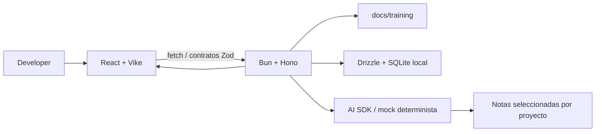

# Arquitectura implementada

## Flujo de aprendizaje

El sitio incluye una demo sintética del capstone. React captura notas/preguntas y muestra respuesta, estado y referencias. Hono valida el contrato, Drizzle recupera notas con el `projectId` de la ruta y el servicio tutor recibe ese conjunto. El mock determinista selecciona texto con coincidencia de términos; el modo OpenAI opcional valida JSON y limita citas a IDs autorizados. La CI y las pruebas verifican errores, progreso y el flujo principal.

## Límites de componentes

- **Web:** Vike, navegación, lecciones Markdown, progreso, grupos y demo del capstone. ReactMarkdown + remark-gfm y rehype-sanitize renderizan el Markdown sin habilitar HTML crudo.
- **API:** factory Hono testeable, rutas validadas, Zod en request/response/configuración, progreso y roster local, notas por proyecto y tutor.
- **Datos:** Drizzle/SQLite guarda progreso, grupos, proyectos y notas sintéticas. Las lecciones se leen desde `docs/training/` en cada inicio; no se duplica el contenido en JSX ni en la base. Migración `0001_knowledge_base` añade proyectos/notas.
- **Tutor:** fuente Markdown del curso o notas del proyecto solicitado. La respuesta cita referencias permitidas o informa insuficiencia. El mock no llama red. OpenAI requiere proveedor explícito y configuración server-side.
- **Identidad:** el perfil `local-practice` es compartido y solo de desarrollo. `NODE_ENV=production` falla al iniciar mientras no exista gateway SSO compartido y perfil PostgreSQL.

## Decisiones de implementación

- Se conserva el baseline React/Vike/Hono/Drizzle y sus funciones de grupos/proyectos; no se reemplaza con scaffold nuevo.
- El contenido de curso en Markdown es la fuente de verdad; solo la lista de módulos/IDs/orden vive en el registro API.
- La UI permite marcar un módulo completo y guardar reflexión sin checkpoint hard-coded ajeno al contenido fuente.
- `react-markdown`, `remark-gfm` y `rehype-sanitize` se añadieron para mostrar Markdown, tablas/código y evitar renderizar HTML inseguro. Biome se añadió para cumplir formato y lint en CI.
- El paquete `bun` no se instala como dependencia runtime; Bun 1.4.4 queda fijado en `packageManager` y en CI.

## Límite compartido

No hay integración del gateway SSO, PostgreSQL compartido, proveedor/modelo aprobado ni despliegue. Se necesitan owners/parámetros corporativos para esos pasos; no se simula identidad cloud ni se guarda credencial en Git.
